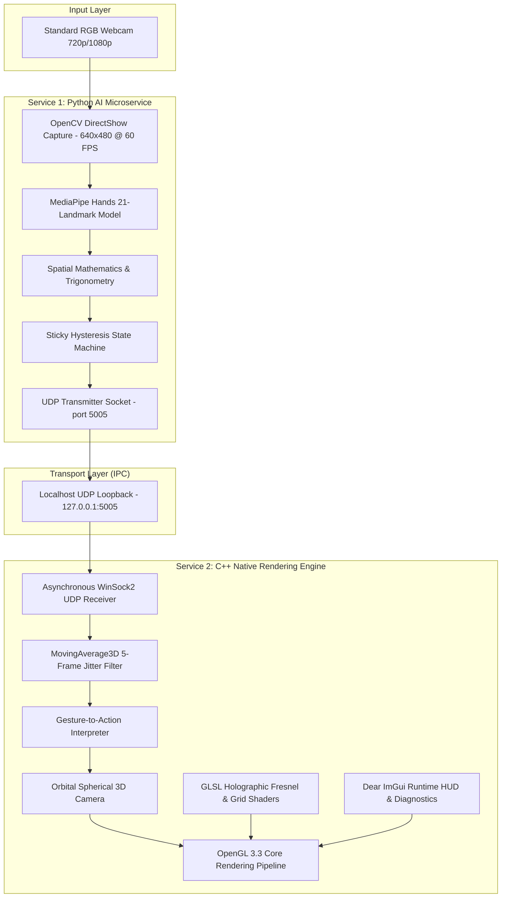

# V.I.S.O.R. — Virtual Interface Spatial Overlay Renderer

<p align="center">
  <b>A Real-Time, Gesture-Driven Spatial Interaction System with Hardware-Accelerated Holographic Rendering</b>
</p>

<p align="center">
  
  
  
  
  
  
  <a href="https://drive.google.com/file/d/1hQurLl3Yx5jViBkcQP0D_BF5NtqwG9mr/view?usp=drive_link"></a>
</p>

---

## 1. Executive Summary

**V.I.S.O.R.** (Virtual Interface Spatial Overlay Renderer) is an interactive spatial computing system designed to render high-fidelity 3D assets with real-time holographic shaders. Spatial navigation, rotation, panning, and zooming within the 3D space are driven entirely by natural hand gestures captured through a standard RGB webcam.

To ensure consistent 60–144+ FPS rendering performance, the system decouples computer vision from graphics rendering into two independent, asynchronous microservices communicating over localhost UDP:
1. **Python AI Microservice**: Extracts 21 3D hand landmarks using Google MediaPipe, performs trigonometric gesture evaluation, and broadcasts telemetry packets.
2. **C++ Native Rendering Engine**: Receives UDP telemetry asynchronously, filters sensor jitter via a 5-frame moving average, updates an orbital spherical camera, and renders models with custom GLSL holographic Fresnel shaders.

---

## 2. System Architecture



---

## 3. Natural Hand Gesture Controls

The system provides intuitive touchless navigation mapped to natural hand gestures:

| Gesture Name | Hand Pose / Action | 3D Viewport Navigation Action |
| :--- | :--- | :--- |
| **`OPEN_PALM`** | Flat hand, 3+ fingers extended | **Orbital Rotation**: Moving the hand rotates the 3D scene around the focal target (Yaw & Pitch). |
| **`PEACE_SIGN`** | Index and middle fingers extended | **Planar Panning**: Translates the camera focal point across the screen plane (Left, Right, Up, Down). |
| **`PINCH`** | Index finger tip touches thumb tip | **Radial Zooming**: Dragging while pinching zooms in and out with high precision. |
| **Dual-Hand** | Two hands visible in frame | **Bimanual Expansion Zoom**: Increasing distance between hands zooms in; bringing hands together zooms out. |
| **`FIST`** | Closed fist (0 extended fingers) | **Instant Snap Reset**: Snaps the camera back to origin, default orientation, and initial distance. |

---

## 4. Quick Start (One-Click Launch)

V.I.S.O.R. includes automated startup scripts that detect missing dependencies, set up virtual environments, install Python packages, compile the C++ engine if needed, and run the system:

### Option A: Double-Click Launcher (Windows Explorer)
Double-click:
```text
start.bat
```

### Option B: PowerShell Terminal
Open PowerShell in the project directory and run:
```powershell
.\start.ps1
```

> **What the startup script does automatically:**
> 1. Verifies system Python (3.10+) and CMake installations.
> 2. Creates the isolated virtual environment `python_ai\venv` if missing.
> 3. Installs dependencies from `python_ai\requirements.txt` (`opencv-python`, `mediapipe`, `numpy`).
> 4. Verifies the C++ binary (`VISOR.exe`). If missing, invokes CMake to build the project in Release mode.
> 5. Launches the headless Python AI microservice in the background.
> 6. Waits 2 seconds for webcam hardware initialization.
> 7. Launches the C++ OpenGL native viewport.
> 8. On viewport exit, terminates background Python processes cleanly.

---

## 5. Detailed Service Documentation

The project includes modular technical documentation for each individual subsystem in the `docs/` directory:

- **[Master Docs Hub (`docs/README.md`)](file:///k:/Final%20Year%20Project/Phase%201/Code%20Implementation/docs/README.md)**: Architectural overview and cross-service specifications.
- **[Python AI Tracking Service (`docs/python_ai_service.md`)](file:///k:/Final%20Year%20Project/Phase%201/Code%20Implementation/docs/python_ai_service.md)**: Deep dive into landmark extraction, Euclidean pinch distance, palm normal vector math, and hysteresis filtering.
- **[C++ Native Rendering Engine Service (`docs/cpp_render_service.md`)](file:///k:/Final%20Year%20Project/Phase%201/Code%20Implementation/docs/cpp_render_service.md)**: OpenGL 3.3 Core graphics pipeline, orbital spherical camera math, holographic Fresnel shaders, and procedural infinite grid.
- **[Telemetry & IPC Service (`docs/telemetry_ipc_service.md`)](file:///k:/Final%20Year%20Project/Phase%201/Code%20Implementation/docs/telemetry_ipc_service.md)**: UDP loopback protocol on port `5005`, JSON schemas, coordinate remapping, and moving-average jitter mitigation.
- **[Orchestration & Packaging Service (`docs/orchestration_and_packaging_service.md`)](file:///k:/Final%20Year%20Project/Phase%201/Code%20Implementation/docs/orchestration_and_packaging_service.md)**: Process lifecycle coordination, camera arbitration, and standalone PyInstaller + CMake production packaging.

---

## 6. Manual Build Instructions

If you prefer to build each component manually:

### 1. Python AI Service
```powershell
cd python_ai
python -m venv venv
.\venv\Scripts\activate
pip install -r requirements.txt
python src\main.py
```

### 2. C++ Rendering Engine
```powershell
cd cpp_render
cmake -B build -G "Visual Studio 17 2022" -A x64
cmake --build build --config Release
.\build\Release\VISOR.exe
```

---

## 7. Technology Stack

- **Computer Vision**: OpenCV (DirectShow), Google MediaPipe Hands, NumPy
- **Graphics & Rendering**: Modern OpenGL 3.3 Core Profile, GLSL, GLFW 3.x, GLAD
- **Mathematics**: GLM (OpenGL Mathematics)
- **GUI & Telemetry Overlay**: Dear ImGui
- **Model Loading**: Assimp, tinyobjloader, stb_image
- **Inter-Process Communication**: Localhost UDP Sockets (WinSock2 / POSIX)
- **Orchestration & Tooling**: PowerShell 5.1+, CMake 3.15+, MSVC C++17

---

## 8. Author & Contact

- **Author**: Kalai Mugilan
- **GitHub**: [@kalai-mugilan-125](https://github.com/kalai-mugilan-125)
- **Email**: [mugilankalai.123@gmail.com](mailto:mugilankalai.123@gmail.com)
- **Resume**: [📄 View Resume (Google Drive)](https://drive.google.com/file/d/1hQurLl3Yx5jViBkcQP0D_BF5NtqwG9mr/view?usp=drive_link)

