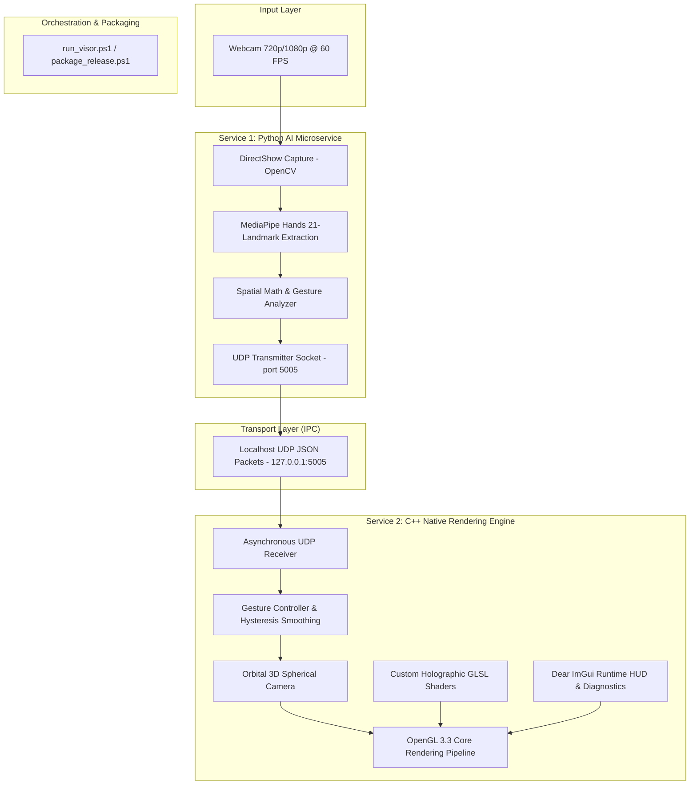

# V.I.S.O.R. — System Documentation

> **Virtual Interface Spatial Overlay Renderer**  
> *Phase 1 Architecture & Modular Service Documentation*

---

## 1. System Overview

**V.I.S.O.R.** is a low-latency, modular spatial computing platform designed for real-time natural hand-gesture navigation within a hardware-accelerated 3D environment. The platform decouples heavy computer vision tracking from graphics rendering into two dedicated, asynchronous microservices communicating over localhost UDP sockets:



---

## 2. Individual Services Index

Each subsystem is maintained as an independent service with dedicated responsibilities, interfaces, and build tooling. Comprehensive technical documentation for each service is linked below:

| Service Document | Primary Technologies | Core Responsibilities |
| :--- | :--- | :--- |
| **[Python AI Tracking Service](file:///k:/Final%20Year%20Project/Phase%201/Code%20Implementation/docs/python_ai_service.md)** | Python 3.10+, OpenCV, MediaPipe, NumPy | RGB frame acquisition, 21-point 3D landmark extraction, Euclidean pinch calculation, palm orientation derivation, gesture state machine, UDP packet generation. |
| **[C++ Native Rendering Engine Service](file:///k:/Final%20Year%20Project/Phase%201/Code%20Implementation/docs/cpp_render_service.md)** | C++17, OpenGL 3.3 Core, GLFW, GLAD, GLM, Dear ImGui | High-performance 3D scene rendering, custom holographic shader pipeline, orbital camera kinematics, gesture smoothing, asset loading, ImGui telemetry overlay. |
| **[Telemetry & IPC Service](file:///k:/Final%20Year%20Project/Phase%201/Code%20Implementation/docs/telemetry_ipc_service.md)** | POSIX / WinSock2 UDP, JSON protocol | Connectionless zero-latency IPC (`127.0.0.1:5005`), JSON schema contracts, coordinate system translation, moving average jitter filtering, hysteresis state locking. |
| **[Orchestration & Packaging Service](file:///k:/Final%20Year%20Project/Phase%201/Code%20Implementation/docs/orchestration_and_packaging_service.md)** | PowerShell 5.1+, PyInstaller, CMake, MSVC | Multi-process development orchestration (`run_visor.ps1`), hardware access arbitration, standalone one-click distribution bundling (`package_release.ps1`). |

---

## 3. Directory Structure

```text
Code Implementation/
├── docs/                                     # Active modular documentation
│   ├── README.md                             # Master documentation hub
│   ├── python_ai_service.md                  # Vision & AI microservice specs
│   ├── cpp_render_service.md                 # Native OpenGL engine specs
│   ├── telemetry_ipc_service.md              # UDP protocol & coordinate math
│   └── orchestration_and_packaging_service.md# Process lifecycle & release scripts
│
├── docs_ignored/                             # Archived legacy docs & review assets (in .gitignore)
│
├── python_ai/                                # Python AI Microservice
│   ├── venv/                                 # Dedicated virtual environment
│   ├── requirements.txt                      # mediapipe, opencv-python, numpy
│   └── src/
│       ├── main.py                           # VisionController orchestration loop
│       ├── tracker.py                        # MediaPipe hand tracking wrapper
│       ├── gestures.py                       # Spatial trigonometry & gesture heuristics
│       └── udp_client.py                     # UDP transmitter socket
│
├── cpp_render/                               # C++ Native Graphics Engine
│   ├── CMakeLists.txt                        # Modern CMake configuration
│   ├── include/                              # Class headers & API definitions
│   │   ├── render_engine.h                   # Top-level graphics orchestrator
│   │   ├── camera.h                          # 3D orbital spherical coordinate camera
│   │   ├── gesture_controller.h              # Gesture mapper & jitter filter
│   │   ├── udp_server.h                      # Non-blocking UDP receiver & deserializer
│   │   ├── window_context.h                  # GLFW window & input abstraction
│   │   ├── shader_manager.h                  # GLSL shader compiler & linker
│   │   ├── spatial_overlay.h                 # Holographic model & transform manager
│   │   └── model.h / mesh.h                  # Assimp 3D model structures
│   ├── src/                                  # Implementation source files (.cpp)
│   └── shaders/                              # GLSL vertex & fragment shaders
│
├── run_visor.ps1                             # Automated dev launch & process manager
├── package_release.ps1                       # Production release packager
└── .gitignore                                # Git tracking rules
```

---

## 4. Quickstart Execution

### Development Mode (Simultaneous Dual Services)
Ensure Python virtual environment is installed and C++ project is compiled:
```powershell
.\run_visor.ps1
```
This PowerShell script automatically activates the Python virtual environment in the background, spins up the headless AI vision loop, launches the C++ OpenGL native viewport, and cleanly kills background processes on exit.

### Production Release Packaging
To build a standalone production distribution with precompiled binaries:
```powershell
.\package_release.ps1
```
The output is stored in `dist/VISOR/` ready for zero-dependency execution.
