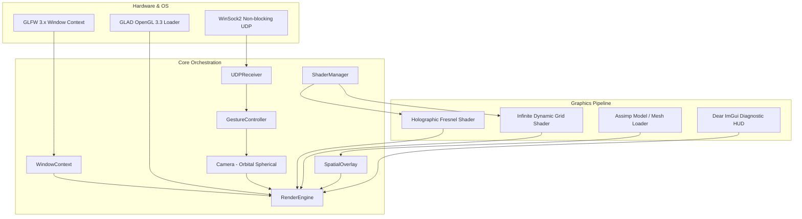

# C++ Native Rendering Engine — Service Documentation

> **Subsystem**: `cpp_render`  
> **Role**: Hardware-Accelerated OpenGL 3.3 Core 3D Rendering, Holographic Shaders, Orbital Camera Kinematics, Gesture-to-Action Translation, and Runtime Diagnostics.

---

## 1. Architectural Overview

The **C++ Native Rendering Engine** is the visual frontend of the V.I.S.O.R. platform. Built with modern C++17 and OpenGL 3.3 Core Profile, it handles high-framerate rendering, OBJ model geometry loading, complex GLSL holographic materials, and real-time transformation of hand gestures into smooth 3D viewport actions.



---

## 2. Source Code Architecture

All headers and implementation files are modularly partitioned across `cpp_render/include/` and `cpp_render/src/`:

```text
cpp_render/
├── CMakeLists.txt                 # CMake build script
├── include/
│   ├── render_engine.h            # Primary engine orchestrator & render loop
│   ├── window_context.h           # GLFW window & viewport wrapper
│   ├── camera.h                   # 3D spherical orbital camera
│   ├── gesture_controller.h       # Telemetry interpreter & hysteresis filter
│   ├── udp_server.h               # Non-blocking UDP receiver & deserializer
│   ├── shader_manager.h           # GLSL compilation & uniform binder
│   ├── spatial_overlay.h          # Model transform & visual container
│   ├── model.h / mesh.h           # Mesh geometry & vertex buffer layout
│   ├── model_loader.h             # Assimp / 3D model importer
│   ├── texture.h / material.h     # Texture sampling & material parameters
│   └── embedded_shaders.h         # Fallback compiled-in GLSL shaders
└── src/
    ├── main.cpp                   # Application entry point
    ├── render_engine.cpp          # Render loop, grid generation, lighting
    ├── window_context.cpp         # GLFW callback management
    ├── camera.cpp                 # Spherical math, view matrix generation
    ├── gesture_controller.cpp     # Smooth gesture-to-camera command mapping
    ├── udp_server.cpp             # WinSock UDP polling & JSON unpacking
    ├── shader_manager.cpp         # Shader linking & error diagnostic logs
    ├── spatial_overlay.cpp        # Scene node transformation updates
    ├── model.cpp / mesh.cpp       # VAO/VBO/EBO construction
    ├── model_loader.cpp           # Node hierarchy traversal
    └── texture.cpp                # stb_image GPU upload
```

---

## 3. Subsystem Breakdown

### 3.1. RenderEngine (`render_engine.h` / `render_engine.cpp`)
[RenderEngine](file:///k:/Final%20Year%20Project/Phase%201/Code%20Implementation/cpp_render/include/render_engine.h#L36-L100) orchestrates all application systems:
- **Initialization**: Configures GLFW, loads OpenGL 3.3 Core pointers via GLAD, initializes ImGui, binds UDP sockets, and compiles shaders.
- **Main Render Loop**:
  1. Polls input events and asynchronous UDP telemetry packets.
  2. Updates orbital camera and model transform matrices.
  3. Clears framebuffers (`GL_COLOR_BUFFER_BIT | GL_DEPTH_BUFFER_BIT`).
  4. Renders the infinite mathematical ground grid.
  5. Renders 3D mesh instances with the holographic Fresnel shader.
  6. Renders Dear ImGui HUD overlays.
  7. Swaps GLFW front/back buffers (`glfwSwapBuffers`).
- **Child Process Lifecycle**: In packaged builds, launches and cleanly terminates the headless background Python AI executable via Windows API (`CreateProcess` / `TerminateProcess`).

### 3.2. Camera System (`camera.h` / `camera.cpp`)
[Camera](file:///k:/Final%20Year%20Project/Phase%201/Code%20Implementation/cpp_render/include/camera.h) implements Blender/Maya-style orbital spherical coordinate navigation:
- **Spherical Coordinates**:
  - Azimuthal Angle (Yaw $\theta$)
  - Elevation Angle (Pitch $\phi$, clamped to $[-89^\circ, +89^\circ]$ to prevent gimbal lock)
  - Orbital Radius (Distance $r$, clamped between minimum and maximum zoom limits)
- **Cartesian Eye Position Calculation**:
  $$\mathbf{E}_x = \mathbf{T}_x + r \cdot \cos(\phi) \cdot \sin(\theta)$$
  $$\mathbf{E}_y = \mathbf{T}_y + r \cdot \sin(\phi)$$
  $$\mathbf{E}_z = \mathbf{T}_z + r \cdot \cos(\phi) \cdot \cos(\theta)$$
  where $\mathbf{T}$ is the 3D focal target point.
- **View Matrix**:
  $$\mathbf{V} = \text{glm::lookAt}(\mathbf{E}, \mathbf{T}, \mathbf{U}_{\text{world}})$$

### 3.3. GestureController (`gesture_controller.h` / `gesture_controller.cpp`)
[GestureController](file:///k:/Final%20Year%20Project/Phase%201/Code%20Implementation/cpp_render/include/gesture_controller.h#L30-L98) translates raw telemetry into butter-smooth camera movement:
- **MovingAverage3D Filter**: Maintains a 5-element sliding window across $(x, y, z)$ wrist/pinch points to eradicate webcam landmark high-frequency jitter:
  $$\mathbf{P}_{\text{smoothed}} = \frac{1}{N} \sum_{i=0}^{N-1} \mathbf{P}_i$$
- **Hysteresis Gesture Confirmation**: Requires a candidate gesture to persist for $k=2$ consecutive frames before switching state (`m_lockedGesture`), preventing brief misclassifications from interrupting active drags.
- **Navigation Action Mapping**:

| Detected Gesture | Trigger Condition | Camera Navigation Action |
| :--- | :--- | :--- |
| **`OPEN_PALM`** | Palm facing camera | **Orbital Rotation**: Translates horizontal/vertical hand delta $(\Delta x, \Delta y)$ to Yaw and Pitch orbit. |
| **`PEACE_SIGN`** | 2 extended fingers | **Planar Panning**: Translates hand displacement in camera-local Right and Up axes to pan the focal target $\mathbf{T}$. |
| **`PINCH`** | Thumb & index locked | **Radial Zooming**: Vertical hand drag or radial pinch closure adjusts camera distance $r$. |
| **Dual Hand** | Two hands in view | **Bimanual Expansion Zoom**: Increasing distance between two hands zooms in; bringing them together zooms out. |
| **`FIST`** | 0 extended fingers | **Instant Reset**: Snaps camera back to default orientation, zoom, and center. |

### 3.4. Shading & Visual Architecture

#### A. Holographic Fresnel Rim Shader (`holographic.frag`)
Produces an iconic sci-fi spatial overlay appearance using view-dependent rim calculations:
$$I_{\text{Fresnel}} = \left( 1.0 - \max(\vec{N} \cdot \vec{V}, 0.0) \right)^{\text{power}}$$
- **Dynamic Scanlines**: Modulated via high-frequency sinusoidal functions across model Y coordinates:
  $$\text{Scan} = 0.85 + 0.15 \cdot \sin(y \cdot 80.0 + t \cdot 4.0)$$
- **Emissive Chroma Glow**: Dynamically tinted with customizable base colors (cyan, amber, emerald).

#### B. Infinite Ray-Traced Grid
Renders an infinite procedural grid on the XY/XZ plane directly in the fragment shader without generating large vertex meshes:
- Projects a full-screen screen quad $(-1 \dots 1)$.
- Unprojects near/far clip points into world space.
- Calculates ground plane intersection: $t = -P_{\text{near}, y} / (P_{\text{far}, y} - P_{\text{near}, y})$.
- Samples anti-aliased grid step functions (`fwidth`) to prevent Moiré aliasing at the horizon.

---

## 4. Diagnostics & Dear ImGui Integration

The engine embeds a Dear ImGui HUD that displays real-time performance and telemetry metrics:
- **Frame Rate & Latency**: Instantaneous FPS and frame time in milliseconds.
- **Tracking HUD**: Displays hand count, active gesture string, and detected actions (e.g. `[ORBIT] Delta Yaw: +1.2`).
- **Shader Parameter Controls**: Interactive sliders to adjust Fresnel power, scanline speed, grid color, and lighting vectors.

---

## 5. Build & Compilation Guide

### Requirements
- **CMake**: 3.15 or newer
- **C++ Compiler**: MSVC (Visual Studio 2022 / Build Tools) with C++17 support
- **OpenGL Drivers**: Compatible with OpenGL 3.3 Core Profile

### Building via CMake
```powershell
cd "k:\Final Year Project\Phase 1\Code Implementation\cpp_render"
cmake -B build -G "Visual Studio 17 2022" -A x64
cmake --build build --config Release
```
The compiled executable will be located at:
`cpp_render\build\Release\visor.exe`
