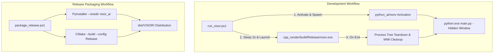

# Orchestration & Packaging Service — Service Documentation

> **Subsystem**: `orchestration_and_packaging`  
> **Role**: Multi-Process Development Coordination, Hardware Arbitration, Lifecycle Teardown, and Standalone Production Bundling.

---

## 1. Architectural Overview

Running V.I.S.O.R. involves coordinating two distinct software runtimes:
1. An interpreted, deep-learning Python 3.10+ microservice (`python_ai`).
2. A compiled, hardware-accelerated C++17 native binary (`cpp_render`).

The orchestration service automates environmental activation, startup synchronization, hardware initialization delays, and clean multi-process termination. For deployment, it packages both runtimes into a self-contained production bundle.



---

## 2. Development Orchestration (`run_visor.ps1`)

[run_visor.ps1](file:///k:/Final%20Year%20Project/Phase%201/Code%20Implementation/run_visor.ps1) is the master launcher for everyday development and testing.

### 2.1. Execution Workflow
1. **Pre-flight Sanity Checks**:
   - Verifies the existence of `python_ai\venv\Scripts\python.exe`.
   - Verifies the compiled C++ executable at `cpp_render\build\Release\visor.exe`.
2. **Headless Python Startup**:
   - Spawns a background CMD shell with `-WindowStyle Hidden` executing `activate.bat` and launching `main.py`.
   - Runs in the background without cluttering the developer's desktop with extraneous console windows.
3. **Hardware Camera Staging Delay**:
   - Pauses for 2 seconds (`Start-Sleep -Seconds 2`) to allow the DirectShow webcam driver to negotiate frame format and lock auto-exposure before OpenGL window initialization.
4. **Synchronous Foreground Graphics Loop**:
   - Launches `visor.exe` with `-Wait`, blocking the PowerShell orchestrator until the user closes the 3D window.
5. **Deterministic Teardown & Zombie Process Cleanup**:
   - Halts the parent CMD process.
   - Queries Windows Management Instrumentation (`Win32_Process`) via WMI filter `CommandLine LIKE '%main.py%'` to ensure child Python worker processes are forcibly terminated, releasing webcam access immediately.

---

## 3. Standalone Release Packager (`package_release.ps1`)

[package_release.ps1](file:///k:/Final%20Year%20Project/Phase%201/Code%20Implementation/package_release.ps1) produces a standalone binary distribution in `dist\VISOR\` that runs on any modern 64-bit Windows machine without requiring Python or Visual Studio to be installed.

### 3.1. Packaging Pipeline Stages

#### Stage 1: Clean Distribution Staging
Clears previous build artifacts and creates an isolated output directory `dist\VISOR\`.

#### Stage 2: Freezing the Python AI Service (PyInstaller)
Compiles the Python source code and runtime dependencies into a self-contained one-dir bundle:
```powershell
pyinstaller --noconfirm --onedir --windowed `
    --name "visor_ai" `
    --distpath "python_ai\dist_py" `
    --workpath "python_ai\build_py" `
    --collect-all "mediapipe" `
    --collect-all "cv2" `
    "python_ai\src\main.py"
```
- Bundles the Python interpreter, OpenCV C++ binaries, and MediaPipe TFLite model weights.

#### Stage 3: Compiling C++ Render Engine (CMake Release)
Builds optimized native binaries targeting the MSVC x64 Release configuration:
```powershell
cmake --build cpp_render/build --config Release
```

#### Stage 4: Layout Assembly
Assembles the final production release tree:
```text
dist/VISOR/
├── VISOR.exe                  # Primary application entry point
├── visor_ai/                  # Embedded Python AI microservice bundle
│   ├── visor_ai.exe
│   └── ...
├── shaders/                   # GLSL shader files (if external shaders enabled)
└── assets/                    # 3D model geometry & textures
```

---

## 4. Diagnostics & Troubleshooting

| Issue / Symptom | Root Cause | Solution |
| :--- | :--- | :--- |
| **`[ERROR] Python virtual environment not found`** | Missing virtual environment in `python_ai`. | Run `python -m venv venv` and install `requirements.txt`. |
| **`[ERROR] C++ Executable not found`** | C++ project has not been compiled yet. | Build CMake target: `cmake --build build --config Release`. |
| **Camera fails to initialize / black screen** | Another application (Zoom, Teams, or zombie Python process) is holding the camera. | Run `Get-Process python | Stop-Process` or inspect with Task Manager. |
| **Port 5005 address already in use** | Lingering socket listener from an unclosed session. | Check port holder: `netstat -ano \| findstr :5005` and terminate the PID. |
