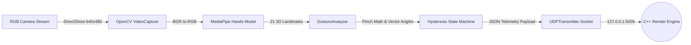

# Python AI Microservice — Service Documentation

> **Subsystem**: `python_ai`  
> **Role**: Real-Time Computer Vision, Hand Landmark Extraction, Spatial Gesture Recognition, and UDP Telemetry Transmission.

---

## 1. Architectural Overview

The **Python AI Microservice** runs as a high-speed, headless background process dedicated entirely to processing webcam video input. By offloading intensive deep-learning inference to this separate process, the application ensures that rendering frame rates (60–144+ FPS in C++) remain decoupled from camera capture hardware rates (typically 30–60 FPS).



---

## 2. Source Code Architecture

All source code for this service is contained within `python_ai/src/`:

```text
python_ai/
├── requirements.txt           # Python dependencies
├── venv/                      # Isolated virtual environment
└── src/
    ├── main.py                # VisionController: Master capture & coordination loop
    ├── tracker.py             # MediaPipeTracker: Neural pipeline wrapper
    ├── gestures.py            # GestureAnalyzer: Trigonometric analysis & hysteresis
    └── udp_client.py          # UDPTransmitter: High-speed UDP socket broadcaster
```

---

## 3. Component Deep Dive

### 3.1. VisionController (`main.py`)
[VisionController](file:///k:/Final%20Year%20Project/Phase%201/Code%20Implementation/python_ai/src/main.py#L8-L69) manages hardware acquisition, thread timing, and subsystem communication:
- **DirectShow Camera Backend**: Instantiates `cv2.VideoCapture(0, cv2.CAP_DSHOW)` on Windows to bypass MSMF (Media Foundation) startup latency and driver negotiation overhead.
- **Hardware Fallback**: Automatically falls back to standard index `0` if DirectShow fails to open the device.
- **Frame Rate & Resolution Locking**: Clamps frame resolution to `640x480` at 60 FPS, providing an optimal trade-off between inference accuracy and CPU footprint.
- **Dynamic Sleep Throttling**: Yields `0.001s` per iteration (`time.sleep(0.001)`) to avoid CPU thread starvation while keeping pipeline latency sub-millisecond.

### 3.2. MediaPipeTracker (`tracker.py`)
[MediaPipeTracker](file:///k:/Final%20Year%20Project/Phase%201/Code%20Implementation/python_ai/src/tracker.py#L4-L37) wraps Google's MediaPipe Hands ML solution:
- **Tracking Configuration**:
  - `static_image_mode = False`: Uses tracking between frames rather than invoking full palm detection on every frame.
  - `max_num_hands = 2`: Tracks up to two concurrent hands simultaneously for two-handed composite gestures (e.g., dual-hand zoom).
  - `min_detection_confidence = 0.7`: Minimizes false-positive hand detection.
  - `min_tracking_confidence = 0.5`: Maintains smooth landmark tracking across motion blur.
- **Landmark Normalization**: Extracts 21 keypoints per hand in normalized coordinate space $[x, y, z]$, where:
  - $x \in [0.0, 1.0]$: Normalized horizontal position across frame width.
  - $y \in [0.0, 1.0]$: Normalized vertical position down frame height.
  - $z$: Relative depth landmark coordinate relative to the wrist.

### 3.3. GestureAnalyzer (`gestures.py`)
[GestureAnalyzer](file:///k:/Final%20Year%20Project/Phase%201/Code%20Implementation/python_ai/src/gestures.py#L3-L89) performs spatial mathematics and gesture classification:

#### A. 3D Euclidean Pinch Calculation
Pinch distance is evaluated between Landmark 4 (Thumb Tip) and Landmark 8 (Index Tip):
$$\text{dist} = \|\mathbf{P}_{\text{index}} - \mathbf{P}_{\text{thumb}}\|_2 = \sqrt{(x_8 - x_4)^2 + (y_8 - y_4)^2 + (z_8 - z_4)^2}$$

#### B. Palm Orientation & Normal Plane Estimation
Palm 3D spatial rotation (Pitch, Yaw, Roll) is estimated by constructing an orthonormal basis using the Wrist (0), Index MCP (5), and Pinky MCP (17):
- $\vec{V}_y = \mathbf{P}_{\text{index\_mcp}} - \mathbf{P}_{\text{wrist}}$ (Longitudinal hand vector)
- $\vec{V}_x = \mathbf{P}_{\text{pinky\_mcp}} - \mathbf{P}_{\text{index\_mcp}}$ (Transverse hand vector)
- $\vec{N}_{\text{palm}} = \vec{V}_x \times \vec{V}_y$ (Normal vector orthogonal to palm surface)

Euler angles are extracted via quadrant-aware arc tangent:
$$\text{Pitch} = \text{atan2}(V_{y, y}, V_{y, z})$$
$$\text{Yaw} = \text{atan2}(N_{x}, N_{z})$$
$$\text{Roll} = \text{atan2}(V_{x, y}, V_{x, x})$$

#### C. Sticky Hysteresis State Machine
To eliminate chattering and accidental drops during fine drag interactions:
- **Enter Pinch Threshold**: Distance must drop below `0.03` ($d < 0.03$).
- **Exit Pinch Threshold**: Distance must exceed `0.10` ($d > 0.10$).
- Once locked, small finger oscillations within the `[0.03, 0.10]` band cannot interrupt active pan/zoom operations.

#### D. Finger Extension Heuristics
When not pinching, the state machine evaluates finger extension by comparing fingertips to PIP (Proximal Interphalangeal) joints:
$$\text{Finger Extended} \iff y_{\text{tip}} < y_{\text{pip}} \quad (\text{since } y=0 \text{ is top of frame})$$
- `0 fingers up` $\to$ **`FIST`** (Camera reset trigger)
- `1 finger up` $\to$ **`POINTING`** (Spatial cursor pointing)
- `2 fingers up` $\to$ **`PEACE_SIGN`** (Camera orbital pan)
- `$\ge 3$ fingers up` $\to$ **`OPEN_PALM`** (Orbital rotational navigation)

### 3.4. UDPTransmitter (`udp_client.py`)
[UDPTransmitter](file:///k:/Final%20Year%20Project/Phase%201/Code%20Implementation/python_ai/src/udp_client.py#L4-L19) handles asynchronous telemetry packet broadcast:
- Uses standard non-blocking `socket.AF_INET, socket.SOCK_DGRAM`.
- Configured with `SO_SNDBUF = 65536` for high throughput and zero socket backlog.
- Serializes telemetry with `json.dumps(..., separators=(',', ':'))` for minimal byte footprint.

---

## 4. Telemetry Output Format

When one or more hands are detected, the service transmits packets formatted as:
```json
{
  "active": true,
  "landmarks": [[0.52, 0.61, -0.02], ...],
  "pinch_distance": 0.024,
  "palm_rotation": [0.15, -0.08, 0.02],
  "gesture": "PINCH",
  "hands": [
    {
      "landmarks": [[0.52, 0.61, -0.02], ...],
      "pinch_distance": 0.024,
      "palm_rotation": [0.15, -0.08, 0.02],
      "gesture": "PINCH"
    }
  ]
}
```

When no hands are in the camera view:
```json
{
  "active": false,
  "hands": []
}
```

---

## 5. Development & Execution

### Environment Setup
```powershell
cd "k:\Final Year Project\Phase 1\Code Implementation\python_ai"
python -m venv venv
.\venv\Scripts\activate
pip install -r requirements.txt
```

### Standalone Service Run
```powershell
python .\src\main.py
```
Outputs:
```text
[V.I.S.O.R AI] Headless Vision Microservice Active (Port 5005)...
```
