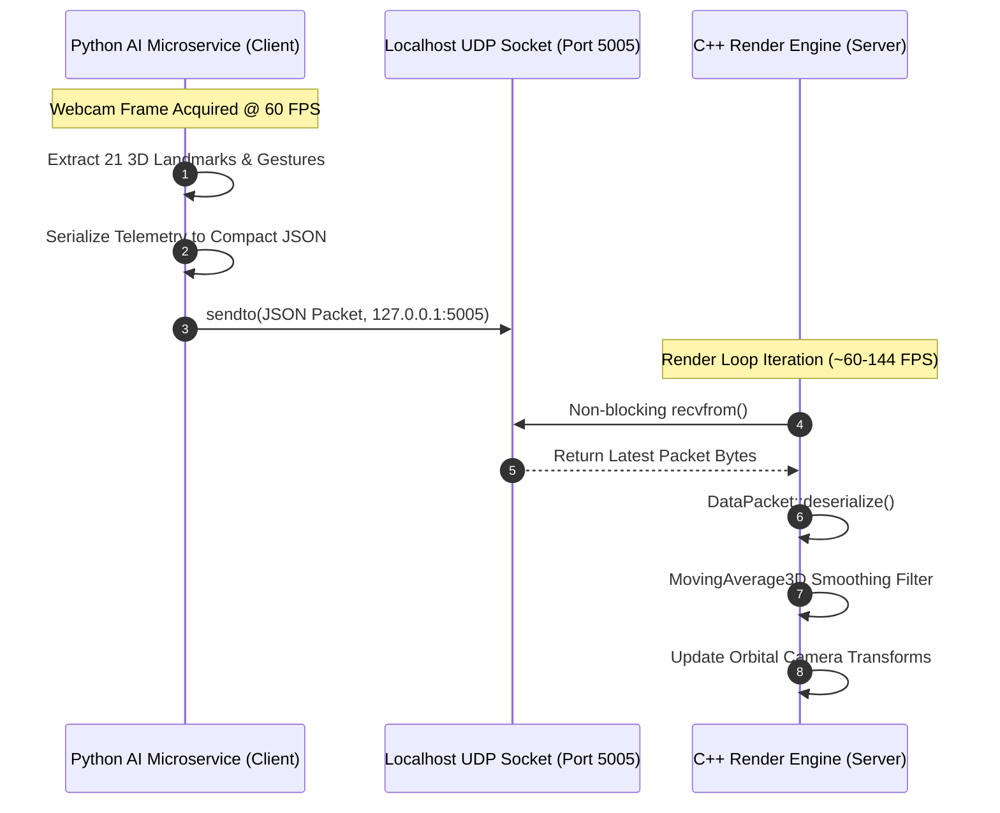

# Telemetry & IPC Service — Service Documentation

> **Subsystem**: `telemetry_ipc`  
> **Role**: Inter-Process Communication (IPC), UDP Network Protocol Specification, Coordinate Space Remapping, and Jitter Reduction Pipelines.

---

## 1. Architectural Overview

To decouple the Python computer vision workload from the C++ hardware-accelerated OpenGL rendering loop, V.I.S.O.R. implements an asynchronous, connectionless **UDP (User Datagram Protocol)** telemetry channel over the local loopback interface (`127.0.0.1:5005`).



---

## 2. Protocol & Transport Characteristics

### 2.1. Why UDP Over TCP or WebSockets?
In interactive real-time spatial interaction, **latency and freshness supersede reliability**:
1. **Zero Head-of-Line Blocking**: TCP retransmits dropped packets and buffers newer ones until dropped packets arrive. In hand tracking, a dropped frame is immediately obsolete—the renderer only cares about where the hand is *now*.
2. **Sub-Millisecond Loopback Latency**: Localhost UDP socket transmission typically completes in $< 0.1\,\text{ms}$, avoiding the protocol overhead and ACK traffic of TCP or HTTP/WebSocket framing.
3. **Connectionless Resiliency**: Either service can be restarted independently without socket renegotiation or broken pipe crashes.

### 2.2. Socket Configurations
- **Transmitter (Python)**:
  - `socket(AF_INET, SOCK_DGRAM)`
  - `SO_SNDBUF = 65536`: High-throughput transmit buffer preventing OS write blocking.
- **Receiver (C++)**:
  - WinSock2 non-blocking socket via `ioctlsocket(recvSocket, FIONBIO, &mode)`.
  - Drains the socket buffer every render frame so that stale packets are discarded, keeping camera movement in lockstep with the latest capture.

---

## 3. JSON Packet Schema Specification

### 3.1. Active Hand Payload (Single & Dual Hand)
```json
{
  "active": true,
  "landmarks": [
    [0.482, 0.612, -0.015],
    [0.463, 0.589, -0.021],
    ...
  ],
  "pinch_distance": 0.0284,
  "palm_rotation": [0.082, -0.145, 0.031],
  "gesture": "PINCH",
  "hands": [
    {
      "landmarks": [[0.482, 0.612, -0.015], ...],
      "pinch_distance": 0.0284,
      "palm_rotation": [0.082, -0.145, 0.031],
      "gesture": "PINCH"
    },
    {
      "landmarks": [[0.710, 0.590, 0.010], ...],
      "pinch_distance": 0.1540,
      "palm_rotation": [-0.040, 0.090, -0.015],
      "gesture": "OPEN_PALM"
    }
  ]
}
```

### 3.2. Idle / Inactive Payload
Sent when the webcam observes no hands in view:
```json
{
  "active": false,
  "hands": []
}
```

### 3.3. Field Definitions
| Field | Type | Description |
| :--- | :--- | :--- |
| `active` | `bool` | Flag indicating whether any valid hand is currently tracked. |
| `gesture` | `string` | Primary gesture state: `"NONE"`, `"PINCH"`, `"FIST"`, `"POINTING"`, `"PEACE_SIGN"`, `"OPEN_PALM"`. |
| `pinch_distance` | `float` | Normalized 3D Euclidean distance between index tip (8) and thumb tip (4). |
| `palm_rotation` | `float[3]` | Euler angles `[Pitch, Yaw, Roll]` estimated from the palm normal vector. |
| `landmarks` | `float[21][3]`| Array of 21 3D coordinates `[x, y, z]` for the primary hand. |
| `hands` | `array<object>`| Full multi-hand array containing landmark and gesture metadata for up to 2 tracked hands. |

---

## 4. Coordinate Transformation & Mathematical Remapping

Webcam capture coordinates and OpenGL 3D viewport coordinates use fundamentally different coordinate systems:

```text
MediaPipe Camera Space                 OpenGL Normalized Device Space (NDC)
   (0, 0) ──────► +X (1, 0)                   (-1, 1) ──────► +X (1, 1)
     │                                           │
     │      [Image Frame]                        │      [Viewport]
     ▼                                           ▼
   +Y (0, 1)      (1, 1)                     (-1, -1)     (1, -1)
```

### Transformation Formulas
To provide intuitive "mirror-like" hand navigation:
1. **Horizontal Mirroring**:
   $$X_{\text{viewport}} = 1.0 - 2.0 \cdot X_{\text{mediapipe}}$$
2. **Vertical Inversion** (converting downward $+Y$ to upward $+Y$):
   $$Y_{\text{viewport}} = 1.0 - 2.0 \cdot Y_{\text{mediapipe}}$$
3. **Depth Coordinate**:
   $$Z_{\text{viewport}} = -Z_{\text{mediapipe}}$$

---

## 5. Jitter Filtering & Hysteresis

Raw webcam landmarks exhibit high-frequency sensor noise. V.I.S.O.R. applies a multi-stage software filtering pipeline in C++ before applying transformations:

### 5.1. Sliding Window Moving Average (`MovingAverage3D`)
A 5-frame moving-average circular buffer dampens high-frequency landmark tremor without introducing noticeable phase lag:
$$\bar{\mathbf{P}}_t = \frac{1}{N} \sum_{i=0}^{N-1} \mathbf{P}_{t-i} \quad \text{where } N = 5$$

### 5.2. Hysteresis Frame Locking
To eliminate gesture flickering (e.g. an unstable boundary between `OPEN_PALM` and `PEACE_SIGN`):
- A candidate gesture must be detected for $k=2$ consecutive frames before the engine promotes it to `m_lockedGesture`.
- Brief 1-frame tracking drops or classification glitches are completely ignored by the active navigation state machine.
